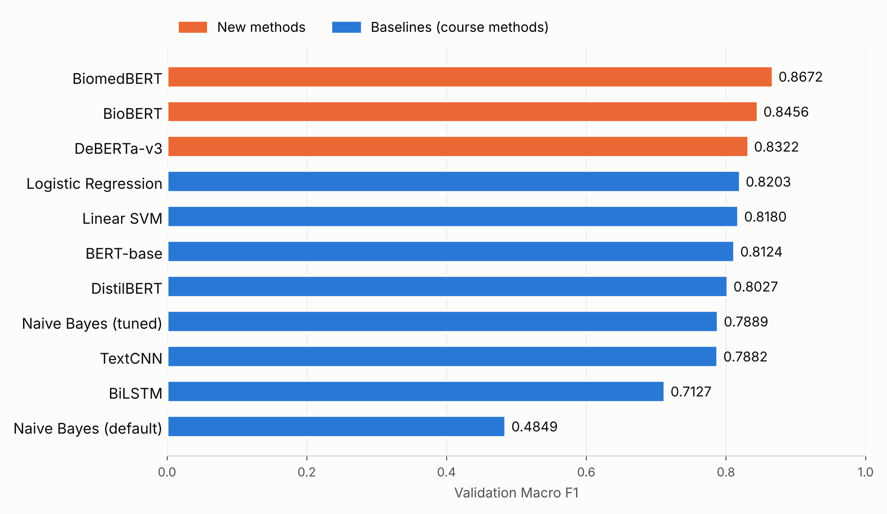
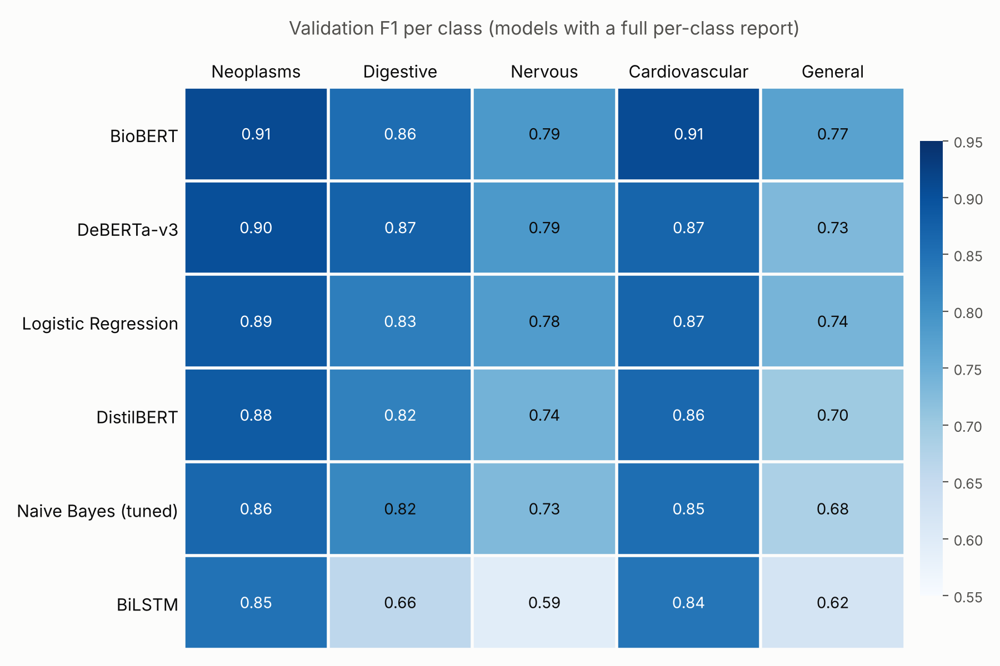

# Benchmark: Medical Abstract Disease Classification

**Task:** single-label, 5-class text classification of medical abstracts
(Neoplasms, Digestive system diseases, Nervous system diseases, Cardiovascular diseases, General pathological conditions).

**Data:** cleaned, leakage-free split (seed 42). Train 5,808 / Validation 1,245 / Test 1,245.
Models are compared on the **validation** set. Every model was tuned and selected on validation only. The final model, BiomedBERT, was evaluated once on the locked test set (Section 5).

---

## 1. Evaluation metric: why Macro F1

**The dataset is imbalanced.** Class shares in the training set:

| Class | Share |
|---|---:|
| General pathological conditions | 28.9% |
| Neoplasms | 26.5% |
| Cardiovascular diseases | 23.6% |
| Nervous system diseases | 12.6% |
| Digestive system diseases | **8.4%** |

The largest class is about 3.4× the smallest. Accuracy is dominated by the large classes, so a model can score well while failing on Digestive or Nervous.

**Macro F1** computes F1 for each class separately and averages them with equal weight. A model only scores well if it works on *every* class, including the small ones. We chose it as the primary metric before training any model.

**Evidence from our own results.** The default Naive Bayes (TF-IDF uni+bigram, alpha = 1.0) reaches **67.6% accuracy** and **0.80 macro precision**, which look acceptable. Its **Macro F1 is 0.48**: it finds only 1 of 105 Digestive abstracts and 9 of 158 Nervous abstracts. Only Macro F1 exposes this failure.

**Other metrics we considered:**

| Metric | Decision |
|---|---|
| Accuracy | Reported, but not used for ranking (dominated by large classes) |
| **Micro F1** | In single-label multiclass classification, Micro F1 = Accuracy, so it is already in the table and has the same weakness |
| Weighted F1 | Reported; it weights classes by size, so it also favours large classes |
| Macro precision / recall | Reported, to show *why* a model's Macro F1 is high or low |
| AUC | Not used for ranking: it measures probability ranking across thresholds, while our task is the final class decision. It also needs probabilities, which not all models provide (e.g. LinearSVC) |

---

## 2. Baselines vs new methods

Following the course definition, **every method presented in the lectures, in its vanilla form, is a baseline.** Methods not covered in the lectures are **new methods**.

| Group | Methods |
|---|---|
| **Baselines** | Naive Bayes, Logistic Regression, Linear SVM, TextCNN, BiLSTM, BERT-base, DistilBERT |
| **New methods** | DeBERTa-v3, BioBERT, BiomedBERT |

---

## 3. Architecture vs specific model

An **architecture** is the design of the network; a **model** is a specific trained instance of it (size, pretraining data, vocabulary).
Four of our transformer models share the **same BERT architecture** and differ only in size or pretraining data. DeBERTa-v3 is a **different architecture**.

| Model (checkpoint / config) | Architecture | What makes this model different |
|---|---|---|
| Multinomial NB (default: TF-IDF uni+bigram, alpha = 1.0) | Probabilistic linear classifier | Untuned; used to show why accuracy is misleading |
| Multinomial NB (tuned: BoW unigram, alpha = 0.5) | Probabilistic linear classifier | Assumes words are independent given the class |
| Logistic Regression (TF-IDF unigram, C = 2, balanced) | Discriminative linear classifier | Learns one weight per word and class |
| Linear SVM (word + character TF-IDF, C = 0.5) | Maximum-margin linear classifier | Learns the widest-margin boundary; character 3–5-grams capture word roots |
| TextCNN (custom, class-weighted) | Convolutional neural network | Trained from scratch; filters detect local n-gram patterns |
| BiLSTM (custom, class-weighted) | Recurrent neural network | Trained from scratch; reads the text in both directions |
| `bert-base-uncased` | Transformer encoder (**BERT**) | 12 layers, ~110M parameters, general English pretraining |
| `distilbert-base-uncased` | Transformer encoder (**BERT**, distilled) | 6 layers, ~66M parameters, distilled from BERT-base |
| `dmis-lab/biobert-base-cased-v1.2` | Transformer encoder (**BERT**) | BERT-base, further pretrained on biomedical text; keeps BERT's general (cased) vocabulary |
| `microsoft/BiomedNLP-BiomedBERT-base-uncased-abstract-fulltext` | Transformer encoder (**BERT**) | BERT-base pretrained **from scratch** on PubMed text with its **own biomedical vocabulary** |
| `microsoft/deberta-v3-base` | Transformer encoder (**DeBERTa**) | Disentangled attention (content and position encoded separately), ELECTRA-style pretraining |

---

## 4. Validation results (ranked by Macro F1)

| Rank | Model | Group | Accuracy (= Micro F1) | **Macro F1** |
|---:|---|---|---:|---:|
| 1 | BiomedBERT | New | 0.8683 | **0.8672** |
| 2 | BioBERT | New | 0.8490 | **0.8456** |
| 3 | DeBERTa-v3 | New | 0.8313 | **0.8322** |
| 4 | Logistic Regression | Baseline | 0.8217 | **0.8203** |
| 5 | Linear SVM | Baseline | 0.8241 | **0.8180** |
| 6 | BERT-base | Baseline | – | **0.8124** |
| 7 | DistilBERT | Baseline | 0.8048 | **0.8027** |
| 8 | Naive Bayes (tuned) | Baseline | 0.7920 | **0.7889** |
| 9 | TextCNN | Baseline | – | **0.7882** |
| 10 | BiLSTM | Baseline | 0.7333 | **0.7127** |
| – | Naive Bayes (default) | Baseline | 0.6755 | **0.4849** |

A dash means the value was not recorded for the canonical run. The hierarchical BiomedBERT variant (stage 1: specific vs general, stage 2: four specific classes) reached 0.8599 macro F1 and was rejected (stage 2 alone: 0.9478).

### Per-class F1 (validation, models with a full per-class report)

| Model | Neoplasms | Digestive | Nervous | Cardiovascular | General |
|---|---:|---:|---:|---:|---:|
| BioBERT | 0.9080 | 0.8558 | 0.7864 | 0.9069 | **0.7708** |
| DeBERTa-v3 | 0.9030 | 0.8720 | 0.7862 | 0.8684 | **0.7311** |
| Logistic Regression | 0.8865 | 0.8282 | 0.7802 | 0.8682 | **0.7385** |
| DistilBERT | 0.8843 | 0.8247 | 0.7410 | 0.8638 | **0.6997** |
| Naive Bayes (tuned) | 0.8646 | 0.8152 | 0.7289 | 0.8539 | **0.6820** |
| BiLSTM | 0.8479 | 0.6609 | 0.5926 | 0.8432 | **0.6191** |

---

## 5. Final model and test results

BiomedBERT was selected as the final model based exclusively on validation Macro F1. It was retrained, saved, and the saved checkpoint was evaluated once on the locked test set.

| Test metric | BiomedBERT |
|---|---:|
| Accuracy | 0.8635 |
| Macro precision | 0.8563 |
| Macro recall | 0.8651 |
| **Macro F1** | **0.8603** |
| Weighted F1 | 0.8623 |

| Neoplasms | Digestive | Nervous | Cardiovascular | General |
|---:|---:|---:|---:|---:|
| 0.9367 | 0.8774 | 0.7975 | 0.9151 | 0.7746 |

Baseline test Macro F1 for comparison: DistilBERT 0.7818, Logistic Regression 0.7759, Naive Bayes (tuned) 0.7542, Naive Bayes (default) 0.4996.

---

## 6. Key findings

1. **Domain-specific pretraining matters most.** BiomedBERT beats BERT-base by about **5.5 Macro F1 points with the same architecture and size** (0.8672 vs 0.8124), so the gain comes from pretraining data and vocabulary, not from model design.
2. **General-purpose transformers do not clearly beat strong classical baselines here.** Logistic Regression and Linear SVM (seconds on a CPU) are slightly ahead of BERT-base and DistilBERT on validation. We used a single split without repeated runs, so we do not claim these small differences are significant.
3. **Models trained from scratch are weakest.** TextCNN and BiLSTM have no pretrained knowledge and only 5,808 training examples.
4. **"General pathological conditions" is the hardest class** for almost every model, including the final BiomedBERT on the test set (F1 0.7746). It is a broad class that overlaps with the other four.

---

## 7. Notes on reported numbers

- **Source:** transformer, TextCNN and BiLSTM numbers come from the team notebooks. Naive Bayes and Logistic Regression come from `src/run_classical.py` (validation grid of 90 runs); its Logistic Regression result reproduces the notebook exactly (0.8203).
- **Naive Bayes:** both versions are reported. The default configuration (0.4849) shows why accuracy is misleading; the tuned one (0.7889) is the fair comparison with the other tuned models.
- **Linear SVM:** the representative result is the word + character TF-IDF model from the team notebook (0.8180).
- **TextCNN:** one canonical run is reported (0.7882).
