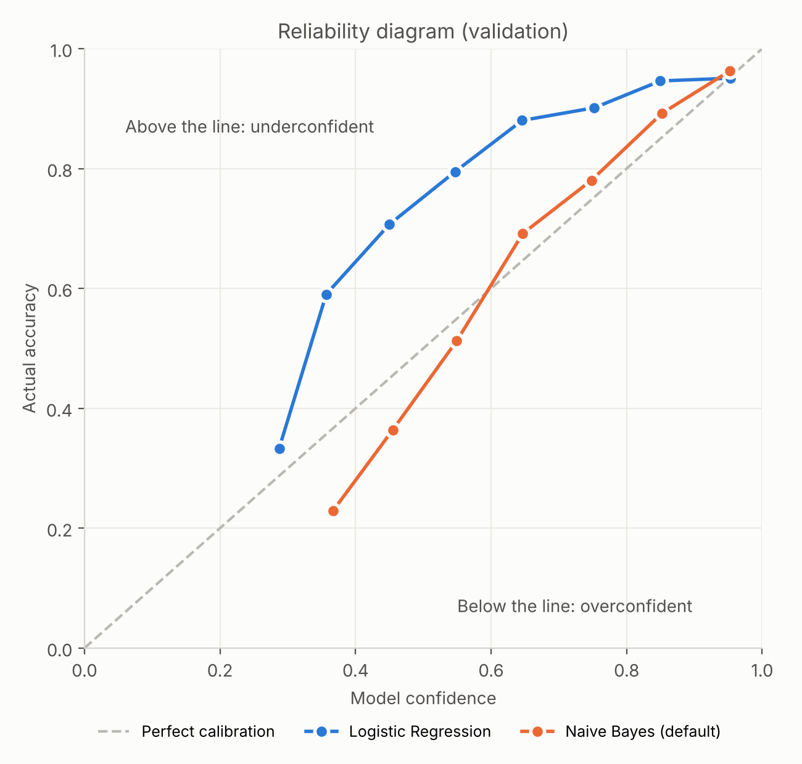

# Medical Abstract Disease Classification

COE025 Natural Language Processing, Project 1 (Text Classification), İstinye University, Fall 2025-26

## Overview

In this project we classify medical research abstracts into one of five disease categories: neoplasms, digestive system diseases, nervous system diseases, cardiovascular diseases, and general pathological conditions. We started from a public dataset, found that its original split had serious problems, cleaned it ourselves, and then compared ten models on the cleaned data, from Naive Bayes up to biomedical transformers.

The short version of what we found: a BERT model pretrained on biomedical text (BiomedBERT) is clearly the best, reaching a macro F1 of 0.860 on the held-out test set, while general-purpose transformers like BERT and DistilBERT end up at roughly the same level as a well-tuned logistic regression on TF-IDF features. Most of the remaining errors come from one class, "general pathological conditions", which overlaps with the other four.

## Problem

Given the abstract of a medical research paper, predict which disease category it is about. This is a single-label, five-class text classification task: each abstract gets exactly one label.

Sorting abstracts by topic is useful for literature search and for organizing large collections of papers, but the task is harder than it looks. Medical abstracts are long and full of technical terms, the classes are not balanced, and one of the five classes ("general pathological conditions") is a broad category that overlaps with the other four. Our goal was to find out how far simple word-based models can go on this task, and how much pretrained and domain-specific language models add on top of them.

## Dataset

We used the Medical Abstracts Text Classification dataset (Schopf et al., 2023). It contains 14,438 abstracts with labels and comes with its own train/test split.

The abstracts are fairly long: the median is 177 words and 97.5% are under 345 words. This means the 512-token limit of the BERT-style models cuts off only a small number of abstracts, and only their last sentences.

The classes are not balanced. After cleaning, general pathological conditions make up 28.9% of the data, neoplasms 26.5%, cardiovascular diseases 23.6%, nervous system diseases 12.6%, and digestive system diseases only 8.4%.

## Cleaning

Before training anything we audited the dataset (`src/01_dataset_audit.py`), and two problems came up.

First, 2,929 abstracts appear more than once with *different* labels. The same text is marked, for example, both as cardiovascular and as a general pathological condition. Since our task gives each abstract exactly one label, there is no correct answer for these. Second, 988 abstracts appear in both the original training and test files, which would let a model be tested on text it had already seen.

So we combined the original files, grouped the abstracts by their exact text, and removed every abstract that had more than one label (`src/02_clean_dataset.py`). That left 8,298 unique abstracts, each with a single label. Every abstract gets a stable ID: the first 16 characters of the SHA-256 hash of its text.

We did not do any other text preprocessing such as lowercasing or stop-word removal at this stage; each model handles its own tokenization.

## Splits

Because the original split was no longer usable, we made a new stratified split with seed 42 (`src/03_create_splits.py`):

| Split | Abstracts |
|---|---:|
| Train | 5,808 |
| Validation | 1,245 |
| Test | 1,245 |

All five classes keep the same proportions in each split, and no abstract appears in more than one split.

All models use the same files and follow the same rules: features such as the TF-IDF vocabulary are fitted on the training set only, every setting (epochs, learning rate, regularization) is chosen on the validation set, and all model selection and hyperparameter decisions were based only on validation performance. Test-set results were not used to tune or select the final BiomedBERT model.

## Metrics

Our main metric is **macro F1**. We chose it before training any model because of the class imbalance described above. Accuracy is dominated by the large classes, so a model can look good while doing poorly on digestive or nervous system diseases. Macro F1 computes the F1 score of each class separately and averages them with equal weight, so every class counts the same.

Our own results show why this matters. Naive Bayes with default settings reaches 67.6% accuracy, which sounds acceptable, but its macro F1 is only 0.48: it finds just 1 of the 105 digestive abstracts and 9 of the 158 nervous system abstracts in the validation set. Accuracy hides this; macro F1 does not.

We also report accuracy (which equals micro F1 for single-label classification), weighted F1, macro precision and macro recall. We did not rank by AUC, because it measures how well probabilities are ordered rather than the final class decision, and not all of our models produce probabilities. [BENCHMARK.md](BENCHMARK.md) explains these choices in more detail.

## Models

We compared ten models. Following the course definition, the methods covered in the lectures are our **baselines**, and the ones we added beyond the lectures are **new methods**.

| Group | Models |
|---|---|
| Baselines | Naive Bayes, Logistic Regression, Linear SVM, TextCNN, BiLSTM, `bert-base-uncased`, `distilbert-base-uncased` |
| New methods | `microsoft/deberta-v3-base`, `dmis-lab/biobert-base-cased-v1.2`, `microsoft/BiomedNLP-BiomedBERT-base-uncased-abstract-fulltext` |

It helps to separate the architecture from the specific model. BERT-base, DistilBERT, BioBERT and BiomedBERT all use the same BERT architecture. What makes them different models is their size (DistilBERT has 6 layers instead of 12) and what they were pretrained on: general English for BERT, additional biomedical text for BioBERT, and biomedical text from scratch, with its own medical vocabulary, for BiomedBERT. DeBERTa-v3 is a different architecture, with a modified attention mechanism.

- **Naive Bayes, Logistic Regression, Linear SVM** work on word counts or TF-IDF weights. They treat each abstract as a bag of words and learn which words point to which class.
- **TextCNN and BiLSTM** are neural networks trained from scratch on our data. TextCNN looks for short word patterns; BiLSTM reads the text in both directions.
- **The transformers** are pretrained on large text collections and then fine-tuned on our training set, with a classification layer on top of the `[CLS]` representation.

## Experiments

**Classical models.** We tuned the classical models on the validation set (`src/run_classical.py` and `04_baseline_benchmark.ipynb`), trying bag-of-words or TF-IDF features, unigrams or unigrams + bigrams, and a small set of settings for each model (Naive Bayes alpha 0.01–1; Logistic Regression and SVM C 0.1–5, with and without balanced class weights). The configurations we report are:

| Model | Features | Settings |
|---|---|---|
| Naive Bayes (default) | TF-IDF, unigrams + bigrams | alpha = 1.0 (scikit-learn default) |
| Naive Bayes (tuned) | Bag of words, unigrams | alpha = 0.5 |
| Logistic Regression | TF-IDF, unigrams | C = 2, balanced class weights |
| Linear SVM | Word + character TF-IDF | C = 0.5 |

We report both Naive Bayes versions on purpose: the default one shows how misleading accuracy can be (see Metrics), and the tuned one is the fair comparison with the other tuned models.

**TextCNN and BiLSTM** were trained with class-weighted loss so that the small classes are not ignored.

**Transformers** were fine-tuned on Google Colab (T4 GPU) with a maximum input length of 512 tokens. For DistilBERT, for example, we used a learning rate of 2e-5, batch size 16, up to 4 epochs with early stopping, weight decay 0.01 and warmup, and kept the epoch with the best validation macro F1. DistilBERT trained in about 6 minutes.

### Hierarchical classification experiment

Error analysis showed that most remaining errors involved General Pathological Conditions, so a two-stage BiomedBERT classifier was tested. Stage 1 classified abstracts as Specific or General, while Stage 2 classified Specific abstracts into the four disease categories. Stage 2 achieved 0.9478 Macro F1, but the combined hierarchical system achieved 0.8599 Macro F1, below the flat BiomedBERT result of 0.8672. The hierarchical approach was therefore rejected because routing errors reduced overall performance.

### Other experiments

We also ran two smaller experiments: a learning curve comparing Naive Bayes and Logistic Regression at different training sizes, and a calibration analysis of how trustworthy the models' confidence scores are.

## Results

The table below shows validation results for all models, ranked by validation macro F1, which is what we used for model selection. Test macro F1 is shown for the final model and for the baselines whose test predictions are in `results/`; a dash means the value is not reported here.

| Model | Group | Val accuracy | Val macro F1 | Test macro F1 |
|---|---|---:|---:|---:|
| **BiomedBERT (final model)** | New | 0.8683 | **0.8672** | **0.8603** |
| BioBERT | New | 0.8490 | 0.8456 | – |
| DeBERTa-v3 | New | 0.8313 | 0.8322 | – |
| Logistic Regression | Baseline | 0.8217 | 0.8203 | 0.7759 |
| Linear SVM | Baseline | 0.8241 | 0.8180 | – |
| BERT-base | Baseline | – | 0.8124 | – |
| DistilBERT | Baseline | 0.8048 | 0.8027 | 0.7818 |
| Naive Bayes (tuned) | Baseline | 0.7920 | 0.7889 | 0.7542 |
| TextCNN | Baseline | – | 0.7882 | – |
| BiLSTM | Baseline | 0.7333 | 0.7127 | – |
| Naive Bayes (default) | Baseline | 0.6755 | 0.4849 | 0.4996 |


The clearest result is that domain-specific pretraining pays off. BiomedBERT has exactly the same architecture and size as BERT-base, yet it scores roughly 5.5 macro F1 points higher on validation (0.8672 vs 0.8124). The difference comes entirely from what it was pretrained on.

General-purpose transformers, on the other hand, do not have a clear advantage over the classical models. On validation, Logistic Regression and Linear SVM are slightly ahead of BERT-base and DistilBERT; on the test set, DistilBERT is slightly ahead of Logistic Regression. These differences are small, and since we used a single train/validation/test split without repeated runs or cross-validation, we do not claim that one of these models is clearly better than the others.

TextCNN and BiLSTM are the weakest. They learn everything from our 5,808 training examples, without any pretrained knowledge of language.

A few smaller observations from the classical models: adding bigrams to TF-IDF did not help, since single medical terms are already very informative. Logistic Regression also beat Naive Bayes at every training size we tried, from 50 to 5,808 examples, so Naive Bayes' main advantage here is speed rather than accuracy.

For the classical models and DistilBERT, test scores are 2 to 4 points lower than validation scores. This is expected, because we picked every setting by looking at validation results. BiomedBERT drops by less than one point (0.8672 to 0.8603).

### Final model selection

BiomedBERT was selected as the final model based exclusively on validation Macro F1. It achieved the best validation score of 0.8672 and outperformed BioBERT, DeBERTa-v3, BERT, the classical baselines, and the hierarchical alternative. The model was retrained, saved, and the saved checkpoint was evaluated once on the locked test set.

| Final test metric | BiomedBERT |
|---|---:|
| Accuracy | 0.8635 |
| Macro precision | 0.8563 |
| Macro recall | 0.8651 |
| **Macro F1** | **0.8603** |
| Weighted F1 | 0.8623 |

Per-class test F1:

| Neoplasms | Digestive | Nervous | Cardiovascular | General |
|---:|---:|---:|---:|---:|
| 0.9367 | 0.8774 | 0.7975 | 0.9151 | 0.7746 |

**Efficiency.** BiomedBERT has 109,486,085 parameters. On a Google Colab T4 GPU, inference over 1,245 validation abstracts took 34.95 seconds, or about 28.07 ms per abstract and 35.62 abstracts per second.

## Error Analysis


For almost every model, the hardest class is general pathological conditions (for BiLSTM it is nervous system diseases). The final BiomedBERT model shows the same pattern on the test set, where General has the lowest F1 (0.7746). In DistilBERT, 212 of its 243 validation errors involve this class, either as the true label or as the prediction. The models rarely confuse two specific disease groups with each other; they mostly struggle to decide whether an abstract is about a specific group or "general".

When we read the errors DistilBERT made with the highest confidence, many of them appeared ambiguous or compatible with more than one category. For example, several abstracts labeled "general" discuss heart-related topics (ventricular fibrillation, left bundle branch block, a heart pump), and the model predicted cardiovascular. Others, such as a study of tumor cells in the nervous system or of polyps in the colon, could reasonably belong to two classes. This matches what we saw in the raw data, where thousands of abstracts had been given more than one label.

**How confident are the models?** If a system like this were used in practice, uncertain predictions could be sent to a person for review. That only works if the model's confidence can be trusted, so we checked it for BiomedBERT, Logistic Regression and Naive Bayes.

The final BiomedBERT model was overconfident: validation accuracy was 86.83%, while mean confidence was 97.06%. Expected Calibration Error was 0.1041. At a confidence threshold of 0.90, 92.61% of validation samples were accepted with 89.68% accuracy. Confidence therefore helps rank uncertain cases, but should not be interpreted as a perfectly calibrated probability.

Logistic Regression turned out to be underconfident (its average confidence is 66%, while it is right 82% of the time), but its confidence still ranks predictions well. If every prediction below 50% confidence goes to a person, 29% of the abstracts are sent for review and accuracy on the rest rises from 82% to 89.5%.

Naive Bayes showed an interesting trade-off. With default settings it is well calibrated but a weak classifier; after tuning, its macro F1 rose from 0.48 to 0.79, but it became extremely overconfident, with 230 of its 259 errors made at over 90% confidence. A model with better accuracy does not automatically have more trustworthy confidence.

The reliability diagram below shows Logistic Regression and the default Naive Bayes.



**Limitations.** We used a single data split without repeated runs or cross-validation, so small differences between models should be read with care. For most models we report only validation results, which are slightly optimistic. Many abstracts appear compatible with more than one category, and a single-label setup forces a choice between them; our two-stage "specific or general" classifier did not solve this, because routing errors reduced overall performance. BiomedBERT is also overconfident, so its raw confidence scores should not be read as probabilities. Finally, the biomedical models may have seen some of these abstracts (but never their labels) during pretraining, which could explain part of their advantage.

## Reproduction

The data pipeline needs only the Python standard library. The classical models and the calibration analysis need `pandas`, `numpy`, `scikit-learn` and `matplotlib`.

```bash
# 1. Data: audit, clean, split
python src/01_dataset_audit.py
python src/02_clean_dataset.py
python src/03_create_splits.py

# 2. Classical models and calibration (validation)
python src/run_classical.py data/processed
python src/calibration_analysis.py data/processed
```

The neural and transformer models are in the notebooks and were run on Google Colab with a T4 GPU. Open a notebook in Colab, choose a GPU runtime, upload `train.csv`, `validation.csv` and `test.csv` from `data/processed/`, and run the cells in order. Because GPU training is not fully deterministic, transformer scores can differ slightly between runs even with the same seed.

## Repo Structure

```
.
├── README.md
├── BENCHMARK.md          detailed benchmark: metric choice, baselines vs new methods, all results
├── LICENSE           MIT license for the code
├── data/
│   ├── raw/              original dataset files, unchanged
│   ├── processed/        cleaned dataset and the train / validation / test split
│   ├── DATASET_SUMMARY.md  source, labels, class distribution, preprocessing steps
│   └── LICENSE           dataset license (CC BY-SA 3.0)
├── reports/              outputs of the audit, cleaning and split scripts
├── src/                  data pipeline and analysis scripts
├── notebooks/            model training notebooks
├── results/              result tables (CSV)
├── figures/              charts used in this README
└── contributions/        one file per team member
```

- **`src/`**: `01_dataset_audit.py` reports duplicates, conflicting labels and train/test overlap without changing any data. `02_clean_dataset.py` removes duplicate and conflicting abstracts. `03_create_splits.py` creates the stratified split. `run_classical.py` trains and tunes the classical models. `calibration_analysis.py` checks the models' confidence scores.
- **`notebooks/`**: `04_baseline_benchmark.ipynb` has the classical models, TextCNN, BiLSTM, BERT, BioBERT, BiomedBERT and DeBERTa-v3. `05_distilbert_classifier.ipynb` fine-tunes DistilBERT.
- **`data/processed/`**: `train.csv`, `validation.csv`, `test.csv` and the full cleaned dataset `medical_abstracts_clean.csv`, each with the columns `abstract_id`, `medical_abstract`, `condition_label` and `condition_name`.
- **`reports/`**: the audit report, the list of conflicting abstracts, the abstracts that appeared in both original files, the cleaning report and the split report.
- **`results/`**: the benchmark table, all classical-model runs, the test results, the calibration summary, prediction files and the learning-curve experiment.

## Contributions

Each member describes their own work in detail in the `contributions/` folder.

| Member | Role | Work |
|---|---|---|
| **Azza Al Mousli** | Dataset, model training | Finding, auditing and cleaning the dataset; notes on the source, labels, class distribution and preprocessing. Training and comparing models in `04_baseline_benchmark.ipynb`, including TextCNN and DeBERTa-v3. |
| **Saleh** | Dataset | Finding, auditing and cleaning the dataset; preparing the cleaned data and splits for training. |
| **Tasneem** | Model research | Researching suitable models, selecting which ones to train and recommending evaluation metrics. BiomedBERT fine-tuning and the Q&A study guide. |
| **Raneem** | Model training, presentation | Training, tuning and comparing models in `04_baseline_benchmark.ipynb`; benchmark table. Presentation slides and project story. |
| **Muhammet Göksenin** | Final testing and evaluation | Test-set evaluation, error analysis, confusion matrices and model limitations. DistilBERT fine-tuning (`05_distilbert_classifier.ipynb`), classical-model tuning, final benchmark, calibration analysis, README. |

All members studied the full project so that everyone can explain the dataset, preprocessing, models, training, testing and evaluation.

## License

The dataset is licensed under CC BY-SA 3.0, and our cleaned version and splits are shared under the same license. The code is released under the MIT License.

If you use the dataset, please cite:

```bibtex
@inproceedings{schopf2023evaluating,
  author    = {Schopf, Tim and Braun, Daniel and Matthes, Florian},
  title     = {Evaluating Unsupervised Text Classification: Zero-Shot and Similarity-Based Approaches},
  booktitle = {Proceedings of the 2022 6th International Conference on Natural Language Processing and Information Retrieval},
  year      = {2023},
  pages     = {6--15},
  doi       = {10.1145/3582768.3582795}
}
```
